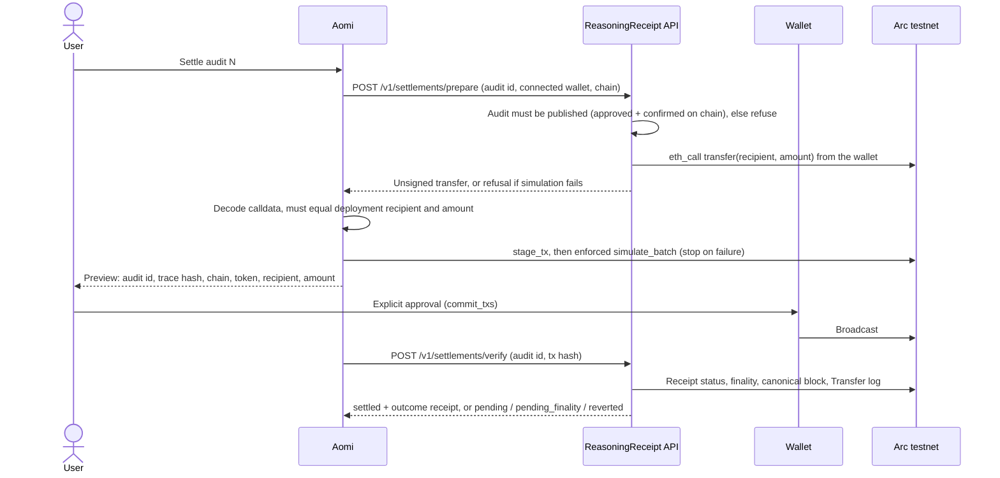

# ReasoningReceipt on Aomi: settlement

This Aomi App settles an **audited** reasoning receipt with one USDC transfer that the
user approves in their own wallet. Only a trace the independent auditor
([integrations/aomi-audit](../aomi-audit/README.md)) approved and published on chain can be
paid for: a pending, sealed or rejected audit blocks settlement. Once the transfer is
independently verified on chain, the API issues a **separate outcome receipt** that links
back to the audited trace, which is never edited.

The API refuses settlement routes until a deployment and API credential are configured.
Hosted app builds use `deployment.arc-testnet.json`, fixing the existing receiver wallet
and 0.01 test USDC amount. Override it with `RR_SETTLEMENT_CONFIG_JSON` or
`RR_SETTLEMENT_CONFIG`; explicit `{"enabled":false}` builds have no EVM namespace.
The API token stays separate in Aomi's runtime secret store.



## Defaults

| | |
|---|---|
| Chain | Arc testnet, `5042002` |
| Token | USDC ERC-20 interface, `0x3600000000000000000000000000000000000000` (6 decimals) |
| Amount | `10000` base units = 0.01 test USDC |
| Recipient | one address from the deployment JSON; placeholder until configured |
| Approval | the user's own wallet; no server-held keys, no unattended signing |

All of these live in one deployment JSON. The app is built from it, and the API reads
the same file, so the model, the trace and the chat cannot change any of them.

## How each requirement is met

| Requirement | Where it is enforced |
|---|---|
| Failed or inconclusive audits block settlement | `/prepare` loads the audit by id and refuses (409) unless its status is `published`, which `/v1/audits/{id}/published` sets only after the auditor approved the trace and its `ReceiptV2` was confirmed final on chain. Pending, sealed and rejected audits prepare nothing, and `/verify` refuses them too. |
| Audited trace stays unchanged and verifiable | Settlement only reads the audit row. The outcome receipt is a new `reasoning-receipt/1` envelope whose `source` node carries the audit id, `trace_hash`, `merkle_root`, `trace_cid`, auditor and publishing transaction. |
| Preview and transaction match chain, recipient, amount | API builds calldata only from the deployment. The app decodes the returned calldata and refuses to stage it unless chain, token, recipient, amount, payer and value all match its build-time deployment. The skill guard limits writes to the configured chain, the USDC contract and `transfer(address,uint256)`. |
| Failed simulation blocks submission | `/prepare` runs `eth_call` from the connected wallet and returns no calldata if it fails. After staging, the route's enforcement runs `simulate_batch` with `on_failure: stop`. Commit happens only after explicit approval. |
| Rejection, pending, reverted or historical transfers never become success | `/prepare` saves the current chain head before returning calldata. `/verify` requires the transfer's block to be strictly after that saved head, status `0x1`, a block at or below `finalized`, a canonical block hash, and exactly one matching `Transfer` log from the prepared wallet. `pending`, `pending_finality` and `reverted` record nothing. A rejected wallet prompt produces no hash, so there is nothing to verify. |
| An in-flight payment cannot be replaced | The first preparation fixes the payer, deployment and starting block. Retrying with the same wallet and deployment keeps that boundary; another wallet or a changed deployment is refused. Existing prepared rows with no saved starting block require manual review rather than silently rebinding a payment that may already have been broadcast. |
| Repeated processing cannot duplicate success | `settlements.source_receipt_hash` (the audited `trace_hash`) and `settlements.transaction_hash` are unique, and the success write is conditional on `status = 'prepared'`. Re-verifying returns the stored outcome; a second transaction or a reused hash is refused. Tests run six concurrent verifications. |

One boundary is worth stating plainly: a plain ERC-20 transfer cannot refuse a second
payment on chain. If a user broadcasts twice before verifying, the second transfer
moves funds but can never become a second success record. The skill tells the agent to
verify the hash it has rather than resubmit.

## Configure for live testing

1. Copy `settlement-deployment.example.json` to `settlement-deployment.json` (ignored by
   git), set the recipient, and set `enabled` to `true`. Keep `api_url` an HTTPS origin.
2. On the API, set `RR_SETTLEMENT_CONFIG` to that file, `RR_SETTLEMENT_RPC_URL` to an Arc
   testnet RPC that supports the `finalized` block tag, and `RR_SETTLEMENT_API_TOKEN` to
   a random token.
   On Vercel, set `RR_SETTLEMENT_CONFIG_JSON` to the JSON object's contents instead of
   relying on a local file. Nonempty inline JSON takes precedence over the file; invalid
   configuration refuses requests without falling back to a different deployment.
3. Build the app with `RR_SETTLEMENT_CONFIG` pointing at the same file. An invalid
   enabled deployment fails the build. Give only `RR_SETTLEMENT_API_TOKEN` to the app's
   environment in Aomi.
   Builds also accept the same `RR_SETTLEMENT_CONFIG_JSON`. This contains public
   deployment values only; the API token stays in the runtime secret store.
4. Publish an audit first (see integrations/aomi-audit), then run one settlement for its
   audit id on Arc testnet through Aomi with a funded test wallet. Keep the outcome
   receipt and check it with `POST /v1/verify`.

Keep the app private until the live acceptance run passes. The committed profile does
not grant signing authority: staging still requires simulation and wallet approval.

## Deploy

The layout follows Aomi's community-app conventions: `.aomi/config.json` at the repo root
points here, the repo-root `Cargo.toml` carries the SDK pin Aomi's deploy gate reads, and
this folder is its own Cargo workspace with `Cargo.lock` beside it. `aomi.toml` sets
`public = false` until the live run passes. Deploy from build.aomi.dev on `main`.

## Develop

```bash
RR_SETTLEMENT_CONFIG_JSON='{"enabled":false}' cargo test --locked # disabled build
cargo test --locked                                             # committed Arc profile
RR_SETTLEMENT_CONFIG=/abs/path/settlement.json cargo test --locked  # configured build
uv run --extra dev pytest tests/test_settlement.py              # API, from the repo root
```
